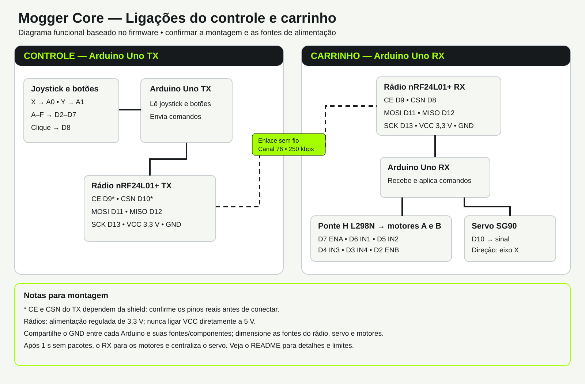
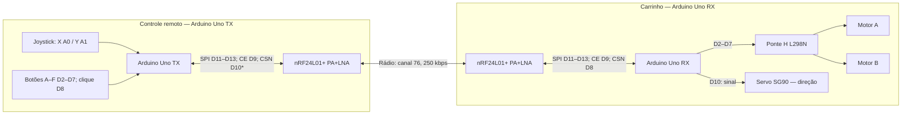

# Ligações do controle e do carrinho

Versão: 30/10/2026. Referência: `Projetos/ctrl-arduino`, ambientes `tx` e `rx` do PlatformIO. Este é um diagrama funcional baseado no código e na documentação existente; as ligações físicas e a alimentação ainda precisam ser conferidas na montagem.

\* Os pinos CE e CSN do TX são os configurados no firmware; a pinagem real da shield ainda não foi identificada e deve ser confirmada.

## Rádio: ligações de cada Arduino

| Sinal nRF24 | TX — controle | RX — carrinho |
| --- | --- | --- |
| CE | D9* | D9 |
| CSN | D10* | D8 |
| MOSI | D11 | D11 |
| MISO | D12 | D12 |
| SCK | D13 | D13 |
| IRQ | Não usado | Não usado |
| VCC | 3,3 V regulados; conferir circuito da shield | 3,3 V regulados |
| GND | GND do TX | GND do RX |

O módulo HW-237 PA+LNA precisa de alimentação de 3,3 V estável e capaz de atender aos picos de corrente; não ligue VCC diretamente em 5 V. Se houver fonte externa, compartilhe o GND com o Arduino correspondente. O projeto recomenda capacitores próximos ao rádio (10–47 µF e 100 nF em paralelo). A capacidade do regulador da shield ou do Uno precisa ser verificada.

## Entradas do controle TX

| Entrada | Pino | Comportamento no firmware |
| --- | --- | --- |
| Botão A | D2 | Frente |
| Botão B | D3 | Giro à direita pelos motores |
| Botão C | D4 | Ré |
| Botão D | D5 | Giro à esquerda pelos motores |
| Botões E e F | D6 e D7 | Enviados, sem ação no receptor |
| Clique do joystick | D8 | Enviado, sem ação no receptor |
| Joystick X | A0 | Direção do servo |
| Joystick Y | A1 | Enviado, sem ação no receptor |

Os botões usam `INPUT_PULLUP` e são considerados pressionados em nível baixo; confirme o circuito real da shield. O TX envia alterações e pacotes periódicos, em intervalos de 30 ms em movimento ou 150 ms em repouso. O pacote contém sequência, botões e os dois eixos.

## Saídas do carrinho RX

| Arduino RX | Componente | Sinal |
| --- | --- | --- |
| D7 | L298N | ENA |
| D6 | L298N | IN1 |
| D5 | L298N | IN2 |
| D4 | L298N | IN3 |
| D3 | L298N | IN4 |
| D2 | L298N | ENB |
| D10 | Servo SG90 | Sinal de controle |

Os motores ficam nas duas saídas da ponte H; sua polaridade e o sentido físico precisam ser conferidos. O código liga ENA e ENB em nível digital, sem controle de velocidade por PWM. Se a placa L298N tiver jumpers que mantenham ENA/ENB ligados, confira sua remoção para que os pinos do Arduino possam controlá-los. O servo precisa de alimentação adequada à sua especificação e GND comum com o RX; a fonte, tensão e distribuição de alimentação dos motores e servo não estão definidas no código e devem ser confirmadas na montagem.

O receptor mapeia X para 0–180° e inicia o servo em 90°. Os botões têm prioridade A, C, D, B quando pressionados simultaneamente. Após mais de 1 segundo sem pacotes, o receptor para os motores e centraliza o servo. O primeiro pacote recebido apenas inicializa o estado dos botões; os comandos passam a ser aplicados nos pacotes seguintes.

## Observações da análise

- Ambos usam canal 76, endereço `RF240`, taxa 250 kbps, CRC de 16 bits e confirmação automática do rádio. O TX não verifica o retorno de `radio.write()`.
- A sequência é enviada, mas o RX não a valida; também não há checksum de aplicação no pacote de controle.
- O README de `ctrl-arduino` descreve um teste antigo com pacote de 12 bytes, diferente dos firmwares atuais que utilizam `ControlPacket`.
- O diagrama não comprova o estado real da montagem, nem define bateria, reguladores, polaridade dos motores ou revisão da shield. Confirme esses itens antes de ligar o circuito.
